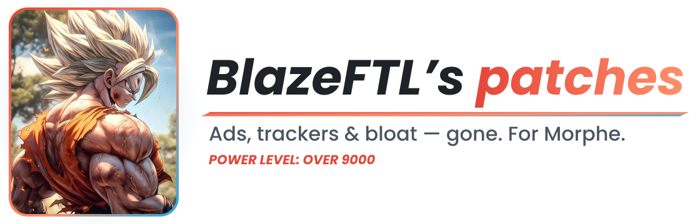

<div align="center">

<picture>
  <source media="(prefers-color-scheme: dark)" srcset=".github/assets/ftl-banner-dark.svg">
  
</picture>

[](https://github.com/BlazeFTL/FTL-Patches/releases)
[](https://github.com/BlazeFTL/FTL-Patches/releases/latest)
[](https://github.com/BlazeFTL/FTL-Patches/stargazers)

<a href="https://morphe.software/add-source?github=BlazeFTL/FTL-Patches" title="Add this source to Morphe">
  
</a>

</div>

## 🔥 About

Strips ads and analytics/crash-reporting SDKs at the bytecode level, cleans build artifacts and dex debug info, trims resource bloat — unused density buckets, unused language packs, lossless PNG recompression — and lets you scale the app's display density independent of system settings, for smaller, cleaner APKs.

## ⚡ Usage

Click **[Add To Morphe↗️](https://morphe.software/add-source?github=BlazeFTL/FTL-Patches)** with Morphe installed, or add `https://github.com/BlazeFTL/FTL-Patches` as a patch source in Morphe. Pick your app, select patches, patch.

## 🐉 Patches list

<!-- PATCHES_START -->
> **[v1.43.7.2-dev.1](https://github.com/BlazeFTL/FTL-Patches/releases/tag/v1.43.7.2-dev.1)**&nbsp;&nbsp;•&nbsp;&nbsp;`dev`&nbsp;&nbsp;•&nbsp;&nbsp;121 patches total
<a id="all-video-downloader-ace-player"></a>
<details>
<summary>&nbsp;&nbsp;All Video Downloader & Ace Player&nbsp;&nbsp;•&nbsp;&nbsp;9 patches</summary>
<br>

**🎯 Supported versions:**

| 1.9.8 |
| :---: |

| 🩹&nbsp;Patch | 🔥&nbsp;Description | ⚙️&nbsp;Options |
|----------|----------------|-----------|
| <a id="all-video-downloader-ace-player-boost-splash-screen"></a>[Boost Splash Screen](patches/src/main/kotlin/app/ftl/patches/AllVideoDownloader/BoostSplashScreenPatch.kt) | Fixes Remove Ads And Remove Ads Lite Gettings Stuck In Splash Screen Useless if you also select skip splash and language activity patch. Also stops the splash from hiding the on-screen navigation buttons. | • Splash duration (ms) |
| <a id="all-video-downloader-ace-player-disable-ad-dialog-when-reopening-app"></a>[Disable ad dialog when reopening app](patches/src/main/kotlin/app/ftl/patches/AllVideoDownloader/DisableOpenAdOnResumePatch.kt) | Prevents the full-screen "loading ad" dialog from appearing when the app is reopened after being minimized. |  |
| <a id="all-video-downloader-ace-player-disable-downloader-from-download-menu"></a>[Disable downloader from download menu](patches/src/main/kotlin/app/ftl/patches/AllVideoDownloader/DisableDownloadHandlerPatch.kt) | Strips WebDownloadActivity's intent-filter data so it no longer offers itself as a handler in the system download/"complete action using" chooser. |  |
| <a id="all-video-downloader-ace-player-disable-persistent-foreground-service"></a>[Disable persistent foreground service](patches/src/main/kotlin/app/ftl/patches/AllVideoDownloader/DisableNotifyServiceForegroundPatch.kt) | Stops the notification shortcut service from running as a foreground service so the app no longer stays alive in the background after being removed from recents. |  |
| <a id="all-video-downloader-ace-player-disable-rate-dialogs"></a>[Disable rate dialogs](patches/src/main/kotlin/app/ftl/patches/AllVideoDownloader/DisableRateDialogsPatch.kt) | Prevents the rate and star rating dialogs from showing. |  |
| <a id="all-video-downloader-ace-player-hide-scan-ad-menu-item"></a>[Hide Scan (AD) menu item](patches/src/main/kotlin/app/ftl/patches/AllVideoDownloader/HideScanAdMenuPatch.kt) | Removes the Scan (AD) row from the browser overflow menu. |  |
| <a id="all-video-downloader-ace-player-remove-from-default-browser-list"></a>[Remove from default browser list](patches/src/main/kotlin/app/ftl/patches/AllVideoDownloader/RemoveBrowserRegistrationPatch.kt) | Removes the unscoped http/https <data> entries from MainActivity's first intent-filter carrying them so the app stops appearing as a candidate in the system's default browser / "open with" chooser. |  |
| <a id="all-video-downloader-ace-player-skip-splash-and-language-screens"></a>[Skip splash and language screens](patches/src/main/kotlin/app/ftl/patches/AllVideoDownloader/SkipSplashAndLanguagePatch.kt) | Jumps straight to the main activity from the splash screen, skipping the splash animation, the language-selection screen, DONT UNSELECT THIS,IT HAS SIGNATURE BYPASS INCLUDED. |  |
| <a id="all-video-downloader-ace-player-skip-tips-screen"></a>[Skip tips screen](patches/src/main/kotlin/app/ftl/patches/AllVideoDownloader/SkipTipsScreenPatch.kt) | Closes the onboarding tips screen as soon as it opens. |  |

</details>

<a id="mx-player"></a>
<details>
<summary>&nbsp;&nbsp;MX Player&nbsp;&nbsp;•&nbsp;&nbsp;11 patches</summary>
<br>

**🎯 Supported versions:**

| 3.4.0 |
| :---: |

| 🩹&nbsp;Patch | 🔥&nbsp;Description | ⚙️&nbsp;Options |
|----------|----------------|-----------|
| <a id="mx-player-boost-splash-screen-time"></a>[Boost Splash Screen Time](patches/src/main/kotlin/app/ftl/patches/MxPlayerAD/BoostSplashScreenPatch.kt) | Dont Apply These Patches Over Some Other Persons Mod, Use Untouched Apk. Disables MX Player's welcome/splash ad so playback starts immediately. Also removes startup network calls and the splash logo. |  |
| <a id="mx-player-clean-me-tab"></a>[Clean Me Tab](patches/src/main/kotlin/app/ftl/patches/MxPlayerAD/CleanMeTabDesPatch.kt) | Adds Mod Settings switches, on by default, that hide promo rows, unused tiles, and Private Folder / File Transfer / Add to Playlist entries. |  |
| <a id="mx-player-configure-smart-enhance"></a>[Configure Smart Enhance](patches/src/main/kotlin/app/ftl/patches/MxPlayerAD/SmartEnhanceConfigurePatch.kt) | Removes the Smart Enhance disable toast and adds Mod Settings switches for the intro popup and the enable toast. |  |
| <a id="mx-player-configure-speedup-overlay"></a>[Configure SpeedUp overlay](patches/src/main/kotlin/app/ftl/patches/MxPlayerAD/ConfigureSpeedUpOverlayPatch.kt) | Fixes the stock leftover-visible-view bug in the long-press SpeedUp overlay. "No UI" is toggled in Me tab > Mod Settings. |  |
| <a id="mx-player-disable-bottom-bar-and-add-me-tab-to-top"></a>[Disable Bottom Bar And Add Me Tab To Top](patches/src/main/kotlin/app/ftl/patches/MxPlayerAD/DisableBottomBarAndAddMeTabPatch.kt) | Adds a permanent Me tab button to the toolbar. Hiding the bottom bar itself is toggled live in Me tab > Mod Settings, not here - the Me tab button always stays wired, on purpose, since Mod Settings lives behind it and turning it off should never be able to lock you out of turning it back on. |  |
| <a id="mx-player-kill-signature-verification"></a>[Kill Signature Verification](patches/src/main/kotlin/app/ftl/patches/MxPlayerAD/DisableSignatureVerificationPatch.kt) | Patches libmx-bh.so to kill signature verification. |  |
| <a id="mx-player-remove-recycle-bin"></a>[Remove Recycle Bin](patches/src/main/kotlin/app/ftl/patches/MxPlayerAD/RemoveRecycleBinPatch.kt) | Deleted files are always removed permanently, whenever this patch is applied - there's no safe way to make that half a runtime switch without the stock (unpatched) delete-dialog code to fall back to. The Me tab tile itself is a Mod Settings switch: off just brings the tile back, it doesn't restore recycling. |  |
| <a id="mx-player-replace-ffmpeg-codec"></a>[Replace FFmpeg codec](patches/src/main/kotlin/app/ftl/patches/MxPlayerAD/ReplaceFfmpegCodecPatch.kt) | Replaces libffmpeg.mx.so in every lib/<abi>/ folder present in the APK with the matching file from a selected codec zip (EAC3 support). neon64 -> arm64-v8a, neon -> armeabi-v7a, x86 -> x86, x86_64 -> x86_64. ABI folders missing from the APK or from the zip are skipped. | • FFmpeg codec zip |
| <a id="mx-player-sidebar-player-defaults"></a>[Sidebar & Player Defaults](patches/src/main/kotlin/app/ftl/patches/MxPlayerAD/CleanPlayerSidebarDefaultsPatch.kt) | Cleans the player sidebar and More menu; sets default shortcuts and subtitle view. Configurable in Mod Settings, except the default shortcuts bitmask, still a Morphe option pending its Mod Settings move. | • Change default shortcuts<br>• Default shortcuts bitmask (hex) |
| <a id="mx-player-smart-enhance-always-on"></a>[Smart Enhance Always On](patches/src/main/kotlin/app/ftl/patches/MxPlayerAD/SmartEnhanceAlwaysOnPatch.kt) | Applies Smart Enhance to every video at a level set in Mod Settings, and keeps it after lock/unlock. |  |
| <a id="mx-player-smart-enhance-slider"></a>[Smart Enhance Slider](patches/src/main/kotlin/app/ftl/patches/MxPlayerAD/SmartEnhanceControlSliderPatch.kt) | Replaces the Smart Enhance toggle with a 0-100% popup slider and keeps the level after lock/unlock. |  |

</details>

<a id="calendar-2026"></a>
<details>
<summary>&nbsp;&nbsp;Calendar 2026&nbsp;&nbsp;•&nbsp;&nbsp;6 patches</summary>
<br>

**🎯 Supported versions:**

| 2.1 |
| :---: |

| 🩹&nbsp;Patch | 🔥&nbsp;Description |
|----------|----------------|
| <a id="calendar-2026-boost-splash"></a>[Boost splash](patches/src/main/kotlin/app/ftl/patches/Calendar2026/BoostSplashPatch.kt) | Removes the splash screen delay. |
| <a id="calendar-2026-disable-caller-related-features"></a>[Disable caller related features](patches/src/main/kotlin/app/ftl/patches/Calendar2026/DisableCallerFeaturesPatch.kt) | Disables caller ID features, the phone state receiver and the permission settings entry. |
| <a id="calendar-2026-skip-consent-form"></a>[Skip consent form](patches/src/main/kotlin/app/ftl/patches/Calendar2026/SkipConsentFormPatch.kt) | Skips the consent form request on launch and continues the splash flow directly. |
| <a id="calendar-2026-skip-initial-setup-pages"></a>[Skip initial setup pages](patches/src/main/kotlin/app/ftl/patches/Calendar2026/SkipInitialSetupPagesPatch.kt) | Skips the phone, overlay and notification permission pages in the initial setup. |
| <a id="calendar-2026-stop-hiding-navigation-keys"></a>[Stop hiding navigation keys](patches/src/main/kotlin/app/ftl/patches/Calendar2026/StopHidingNavigationKeysPatch.kt) | Stops the app from hiding the system navigation bar. |
| <a id="calendar-2026-unlock-purchased-state"></a>[Unlock purchased state](patches/src/main/kotlin/app/ftl/patches/Calendar2026/UnlockPurchasedPatch.kt) | Makes the app treat itself as purchased. |

</details>

<a id="calendar"></a>
<details>
<summary>&nbsp;&nbsp;Calendar&nbsp;&nbsp;•&nbsp;&nbsp;7 patches</summary>
<br>

**🎯 Supported versions:**

| 1.0.35 |
| :---: |

| 🩹&nbsp;Patch | 🔥&nbsp;Description |
|----------|----------------|
| <a id="calendar-boost-splash-screen"></a>[Boost splash screen](patches/src/main/kotlin/app/ftl/patches/Calendar/BoostSplashPatch.kt) | Skips splash ads and the consent request and opens the app immediately. |
| <a id="calendar-disable-caller-features"></a>[Disable caller features](patches/src/main/kotlin/app/ftl/patches/Calendar/DisableCallerFeaturesPatch.kt) | Disables the after call screen and hides its entry in settings. |
| <a id="calendar-disable-rate-us-prompts"></a>[Disable rate us prompts](patches/src/main/kotlin/app/ftl/patches/Calendar/DisableRateUsPatch.kt) | Disables the rate us feedback screen and the periodic rate us prompt. |
| <a id="calendar-remove-battery-optimization-prompt"></a>[Remove battery optimization prompt](patches/src/main/kotlin/app/ftl/patches/Calendar/RemoveBatteryOptimizationPromptPatch.kt) | Removes the battery optimization request on the dashboard. |
| <a id="calendar-skip-initial-setup-pages"></a>[Skip initial setup pages](patches/src/main/kotlin/app/ftl/patches/Calendar/SkipInitialSetupPagesPatch.kt) | Skips the permission and call setup pages shown after the language selection. |
| <a id="calendar-stop-hiding-navigation-keys"></a>[Stop hiding navigation keys](patches/src/main/kotlin/app/ftl/patches/Calendar/StopHidingNavigationKeysPatch.kt) | Keeps the system navigation keys visible. |
| <a id="calendar-unlock-premium"></a>[Unlock premium](patches/src/main/kotlin/app/ftl/patches/Calendar/PremiumUnlockPatch.kt) | Unlocks premium features and hides the premium entry in settings. |

</details>

<a id="file-manager-xfolder"></a>
<details>
<summary>&nbsp;&nbsp;File Manager - XFolder&nbsp;&nbsp;•&nbsp;&nbsp;3 patches</summary>
<br>

**🎯 Supported versions:**

| 1.5.5.7 |
| :---: |

| 🩹&nbsp;Patch | 🔥&nbsp;Description |
|----------|----------------|
| <a id="file-manager-xfolder-change-cleaner-media-tab-defaults"></a>[Change Cleaner & Media Tab Defaults](patches/src/main/kotlin/app/ftl/patches/XFolder/DisableRateAndCleanerDefaultsPatch.kt) | Changes first-run defaults: hides the Image, Video, Audio and Cleaner tabs, and shows hidden files by default. Only affects users who have never changed the setting themselves - the preference override still takes priority. |
| <a id="file-manager-xfolder-disable-rate-us-dialog"></a>[Disable Rate Us Dialog](patches/src/main/kotlin/app/ftl/patches/XFolder/DisableRateAndCleanerDefaultsPatch.kt) | Prevents the in-app rate-us dialog from ever being shown. |
| <a id="file-manager-xfolder-unlock-pro-skip-splash-screen"></a>[Unlock Pro & Skip Splash Screen](patches/src/main/kotlin/app/ftl/patches/XFolder/UnlockProAndSkipSplashPatch.kt) | Forces the ad-removed/Pro check to always return true, and renames the launcher activity from SplashActivity to MainActivity so the splash screen is skipped. |

</details>

<a id="xplayer-video-player"></a>
<details>
<summary>&nbsp;&nbsp;XPlayer - Video Player&nbsp;&nbsp;•&nbsp;&nbsp;16 patches</summary>
<br>

**🎯 Supported versions:**

| 2.9.2 |
| :---: |

| 🩹&nbsp;Patch | 🔥&nbsp;Description |
|----------|----------------|
| <a id="xplayer-video-player-clean-3-dot-menu"></a>[Clean 3 Dot Menu](patches/src/main/kotlin/app/ftl/patches/XPlayer/CleanBottomSheetsPatch.kt) | Removes Lock and Add to playlist from the video and folder 3-dot bottom sheets and from the selection toolbar menus. Toggle in Mod Settings. |
| <a id="xplayer-video-player-disable-rate-dialog"></a>[Disable Rate Dialog](patches/src/main/kotlin/app/ftl/patches/XPlayer/DisableRateDialogPatch.kt) | Disables the rate dialog counters so it never appears. |
| <a id="xplayer-video-player-extra-file-info"></a>[Extra File Info](patches/src/main/kotlin/app/ftl/patches/XPlayer/ExtraFileInfoPatch.kt) | Shows resolution, date, size and last played on video rows, and video count, size and path on folder rows. Fixes the gap above Recent Added and adds a Mod Settings option to hide the Recent Added and Directory rows. Toggles in Mod Settings. |
| <a id="xplayer-video-player-hide-bottom-bar"></a>[Hide Bottom Bar](patches/src/main/kotlin/app/ftl/patches/XPlayer/HideBottomBarPatch.kt) | Hides the bottom tab bar on the home screen. Toggle in Mod Settings. |
| <a id="xplayer-video-player-hide-cast-button"></a>[Hide Cast Button](patches/src/main/kotlin/app/ftl/patches/XPlayer/HideCastButtonPatch.kt) | Hides the cast button in the toolbar menus. Toggle it in Mod Settings. |
| <a id="xplayer-video-player-hide-cast-ff-fb-in-player"></a>[Hide Cast FF FB In Player](patches/src/main/kotlin/app/ftl/patches/XPlayer/HidePlayerCastSeekPatch.kt) | Hides the cast, custom and 10 second forward/backward buttons in the player. Toggle in Mod Settings. |
| <a id="xplayer-video-player-hide-home-tiles"></a>[Hide Home Tiles](patches/src/main/kotlin/app/ftl/patches/XPlayer/HideHomeTilesPatch.kt) | Hides the tile row at the top of the home page (All Videos, Downloader, Privacy, Cleaner...) and the Move to Trash option in the delete dialog. Toggle in Mod Settings. |
| <a id="xplayer-video-player-hide-recent-videos"></a>[Hide Recent Videos](patches/src/main/kotlin/app/ftl/patches/XPlayer/HideRecentVideosPatch.kt) | Hides the recent videos row on the home page. Toggle in Mod Settings. |
| <a id="xplayer-video-player-hide-widgets-menu-item"></a>[Hide Widgets Menu Item](patches/src/main/kotlin/app/ftl/patches/XPlayer/HideWidgetMenuItemPatch.kt) | Removes Widgets from the home 3-dot menu. |
| <a id="xplayer-video-player-mod-settings"></a>[Mod Settings](patches/src/main/kotlin/app/ftl/patches/XPlayer/ModSettingsPatch.kt) | Adds a Mod Settings entry below Settings in the home 3-dot menu. |
| <a id="xplayer-video-player-player-side-cleaned"></a>[Player Side Cleaned](patches/src/main/kotlin/app/ftl/patches/XPlayer/CleanPlayerMenuPatch.kt) | Cleans the player side menu: audio, subtitle, cast, bookmark, favorite, play mode, brightness and volume. Applied while the menu inflates so remaining items stay aligned. Toggle in Mod Settings. |
| <a id="xplayer-video-player-remove-tutorial"></a>[Remove Tutorial](patches/src/main/kotlin/app/ftl/patches/XPlayer/RemoveTutorialPatch.kt) | Removes the player tutorial. |
| <a id="xplayer-video-player-remove-video-enhancer-animation"></a>[Remove Video Enhancer Animation](patches/src/main/kotlin/app/ftl/patches/XPlayer/RemoveEnhancerAnimationPatch.kt) | Skips the Visual Enhancer enable animation and applies effects instantly without reloading the video. Toggle in Mod Settings. |
| <a id="xplayer-video-player-skip-splash-screen"></a>[Skip Splash Screen](patches/src/main/kotlin/app/ftl/patches/XPlayer/SkipSplashPatch.kt) | Launches directly into the file explorer instead of the splash screen. |
| <a id="xplayer-video-player-unlock-pro"></a>[Unlock Pro](patches/src/main/kotlin/app/ftl/patches/XPlayer/UnlockProPatch.kt) | Unlocks all pro features. |
| <a id="xplayer-video-player-volume-booster"></a>[Volume Booster](patches/src/main/kotlin/app/ftl/patches/XPlayer/VolumeBoosterPatch.kt) | Raises the volume boost limit in the player and background playback. Toggle in Mod Settings. |

</details>

<a id="snaptube"></a>
<details>
<summary>&nbsp;&nbsp;SnapTube&nbsp;&nbsp;•&nbsp;&nbsp;4 patches</summary>
<br>

**🎯 Supported versions:**

| 7.68.1.76801201 |
| :---: |

| 🩹&nbsp;Patch | 🔥&nbsp;Description |
|----------|----------------|
| <a id="snaptube-clean-snaptube-settings-page"></a>[Clean SnapTube Settings Page](patches/src/main/kotlin/app/ftl/patches/SnapTube/HideSnaptubeSettingsPatch.kt) | Hides the Download tools and Phone clean categories, and their sub-items, from Settings. |
| <a id="snaptube-disable-annoying-snaptube-notifications"></a>[Disable Annoying Snaptube Notifications](patches/src/main/kotlin/app/ftl/patches/SnapTube/DisableSnaptubeNotificationDefaultsPatch.kt) | Turns off the Toolbar, Recommended contents, and Tool notifications channels by default. |
| <a id="snaptube-remove-watch-ad-to-download"></a>[Remove Watch Ad To Download](patches/src/main/kotlin/app/ftl/patches/SnapTube/RemoveWatchAdToDownloadPatch.kt) | Removes the requirement to watch a rewarded ad before a download starts. |
| <a id="snaptube-remove-from-default-browser-list"></a>[Remove from default browser list](patches/src/main/kotlin/app/ftl/patches/SnapTube/RemoveBrowserRegistrationPatch.kt) | Strips the LinkHandleActivity alias's unscoped so the app stops appearing as a candidate in the system's default browser / "open with" chooser. |

</details>

<a id="xender"></a>
<details>
<summary>&nbsp;&nbsp;Xender&nbsp;&nbsp;•&nbsp;&nbsp;3 patches</summary>
<br>

**🎯 Supported versions:**

| 18.8.0.prime |
| :---: |

| 🩹&nbsp;Patch | 🔥&nbsp;Description |
|----------|----------------|
| <a id="xender-clean-main-ui"></a>[Clean main UI](patches/src/main/kotlin/app/ftl/patches/Xender/CleanMainUiPatch.kt) | Hides the bottom navigation bar, the top-right guide icon, and the Rate/Help/About drawer items, keeps the connect/create/join buttons on top, and stops them from being auto-hidden. |
| <a id="xender-skip-splash-screen"></a>[Skip splash screen](patches/src/main/kotlin/app/ftl/patches/Xender/SkipSplashPatch.kt) | Jumps straight to the main activity from the splash screen, skipping the splash animation entirely. |
| <a id="xender-speed-up-splash-screen"></a>[Speed up splash screen](patches/src/main/kotlin/app/ftl/patches/Xender/FastSplashScreenPatch.kt) | Enters the main activity directly after the splash screen. |

</details>

<a id="rs-file-manager"></a>
<details>
<summary>&nbsp;&nbsp;RS File Manager&nbsp;&nbsp;•&nbsp;&nbsp;6 patches</summary>
<br>

**🎯 Supported versions:**

| 2.3.1.2 |
| :---: |

| 🩹&nbsp;Patch | 🔥&nbsp;Description |
|----------|----------------|
| <a id="rs-file-manager-clean-sidebar"></a>[Clean sidebar](patches/src/main/kotlin/app/ftl/patches/RsFileExplorer/CleanSideBarPatch.kt) | Hides the Bookmarks, remote-connection and Category sections from the navigation sidebar, and hides Encrypt and Downloader from the Storage section. |
| <a id="rs-file-manager-disable-downloader-from-download-menu"></a>[Disable downloader from download menu](patches/src/main/kotlin/app/ftl/patches/RsFileExplorer/DisableDownloadHandlerPatch.kt) | Strips RsDownloadActivity's intent filters so it no longer offers itself as a handler in the system download/"complete action using" chooser. |
| <a id="rs-file-manager-disable-rate-us-dialog"></a>[Disable rate us dialog](patches/src/main/kotlin/app/ftl/patches/RsFileExplorer/DisableRateDialogPatch.kt) | Overrides show() on the in-app "rate us" dialog so it's still built but never displayed. |
| <a id="rs-file-manager-hide-more-actions"></a>[Hide more actions](patches/src/main/kotlin/app/ftl/patches/RsFileExplorer/HideMoreActionsPatch.kt) | Hides Hide, Add to desktop, Encrypt, Decrypt, Add bookmark, Web Search, Copy to, Move to, Transfer, and Playing from the "More actions" menu. |
| <a id="rs-file-manager-hide-network-tools-and-bookmarks-on-home-page"></a>[Hide network, tools and bookmarks on home page](patches/src/main/kotlin/app/ftl/patches/RsFileExplorer/HideHomePageSectionsPatch.kt) | Hides the Network, Tools and Bookmarks sections from the home page section list. |
| <a id="rs-file-manager-skip-splash-screen"></a>[Skip splash screen](patches/src/main/kotlin/app/ftl/patches/RsFileExplorer/SkipSplashScreenPatch.kt) | Skips Splash Screen From 2nd App Opening |

</details>

<a id="firefox-nightly"></a>
<details>
<summary>&nbsp;&nbsp;Firefox Nightly&nbsp;&nbsp;•&nbsp;&nbsp;7 patches</summary>
<br>

**🎯 Supported versions:**

| 161.0a1 |
| :---: |

| 🩹&nbsp;Patch | 🔥&nbsp;Description |
|----------|----------------|
| <a id="firefox-nightly-close-duplicate-tabs"></a>[Close duplicate tabs](patches/src/main/kotlin/app/ftl/patches/FireFox/CloseDuplicateTabsPatch.kt) | Adds Close duplicate tabs to the tab tray 3 dot menu. Toggle in Mod Settings. |
| <a id="firefox-nightly-hide-fullscreen-toast"></a>[Hide fullscreen toast](patches/src/main/kotlin/app/ftl/patches/FireFox/HideFullscreenToastPatch.kt) | Removes the toast shown when a video goes fullscreen. Toggle in Mod Settings. |
| <a id="firefox-nightly-long-press-to-select-tab-range"></a>[Long press to select tab range](patches/src/main/kotlin/app/ftl/patches/FireFox/RangeSelectTabsPatch.kt) | In tab tray selection mode, long press a second tab to select every tab between. Toggle in Mod Settings. |
| <a id="firefox-nightly-new-tab-next-to-current-tab"></a>[New tab next to current tab](patches/src/main/kotlin/app/ftl/patches/FireFox/TabNextToCurrentPatch.kt) | Opens new tabs right after the current tab and adds an add-to-end button (+ with a down arrow) beside + that opens a tab at the end. Both are toggles in Mod Settings. |
| <a id="firefox-nightly-old-style-3-dot-menu-and-extension-pinning"></a>[Old style 3 dot menu And Extension Pinning](patches/src/main/kotlin/app/ftl/patches/FireFox/OldMenuPatch.kt) | Adds "Mod Settings" to the 3 dot menu: switch between the stock bottom sheet menu and the old style popup menu, and pin extensions to the search bar. |
| <a id="firefox-nightly-remember-tab-scroll-position"></a>[Remember tab scroll position](patches/src/main/kotlin/app/ftl/patches/FireFox/RememberTabScrollPositionPatch.kt) | Keeps the tab tray scroll position when it is closed and reopened. |
| <a id="firefox-nightly-tab-scroll-button"></a>[Tab scroll button](patches/src/main/kotlin/app/ftl/patches/FireFox/TabScrollButtonPatch.kt) | Adds up and down buttons beside + in the tab tray that jump to the first and last tab. Toggle in Mod Settings. |

</details>

<a id="mobilism"></a>
<details>
<summary>&nbsp;&nbsp;Mobilism&nbsp;&nbsp;•&nbsp;&nbsp;8 patches</summary>
<br>

**🎯 Supported versions:**

| Any version |
| :---: |

| 🩹&nbsp;Patch | 🔥&nbsp;Description |
|----------|----------------|
| <a id="mobilism-copy-link-button"></a>[Copy link button](patches/src/main/kotlin/app/ftl/patches/Mobilism/CopyLinksPatch.kt) | Adds a copy icon after every link in release details. Configurable in Mod settings. |
| <a id="mobilism-hide-discussions"></a>[Hide discussions](patches/src/main/kotlin/app/ftl/patches/Mobilism/HideDiscussionsPatch.kt) | Hides Recent discussions, Reviews and Contests sections on Home. Configurable in Mod settings. |
| <a id="mobilism-hide-premium"></a>[Hide premium](patches/src/main/kotlin/app/ftl/patches/Mobilism/HidePremiumPatch.kt) | Hides the Go premium button and the premium download button. Configurable in Mod settings. |
| <a id="mobilism-keyword-filter"></a>[Keyword filter](patches/src/main/kotlin/app/ftl/patches/Mobilism/KeywordFilterPatch.kt) | Adds a Keyword filter entry to the 3-dot menu to hide posts by title keywords, with long-press hide and copy. |
| <a id="mobilism-material-colors"></a>[Material colors](patches/src/main/kotlin/app/ftl/patches/Mobilism/MaterialColorsPatch.kt) | Applies the Material red and purple palette to the Apps and Games tabs. |
| <a id="mobilism-mod-settings"></a>[Mod settings](patches/src/main/kotlin/app/ftl/patches/Mobilism/ModSettingsPatch.kt) | Adds a Mod settings entry to the 3-dot menu to show or hide sidebar items and toggle mod features. |
| <a id="mobilism-open-in-latest"></a>[Open in latest](patches/src/main/kotlin/app/ftl/patches/Mobilism/OpenInLatestPatch.kt) | Opens the Latest list for the current content type on launch. Configurable in Mod settings. |
| <a id="mobilism-skip-splash-screen"></a>[Skip splash screen](patches/src/main/kotlin/app/ftl/patches/Mobilism/SkipSplashScreenPatch.kt) | Launches the home screen directly instead of the splash screen. |

</details>

<a id="mixplorer"></a>
<details>
<summary>&nbsp;&nbsp;MiXplorer&nbsp;&nbsp;•&nbsp;&nbsp;1 patch</summary>
<br>

**🎯 Supported versions:**

| Any version |
| :---: |

| 🩹&nbsp;Patch | 🔥&nbsp;Description |
|----------|----------------|
| <a id="mixplorer-disable-from-download-menu-of-browsers"></a>[Disable From Download Menu Of Browsers](patches/src/main/kotlin/app/ftl/patches/MiXplorer/DisableDownloadChooserPatch.kt) | Removes only the http/https <data> entries from MiXplorer's Explore/Download/Copy to/Extract to shell activities' VIEW intent filters, so the app stops showing up multiple times in browsers download link chooser. |

</details>

<a id="video-downloader"></a>
<details>
<summary>&nbsp;&nbsp;Video Downloader&nbsp;&nbsp;•&nbsp;&nbsp;7 patches</summary>
<br>

**🎯 Supported versions:**

| 2.7.3 |
| :---: |

| 🩹&nbsp;Patch | 🔥&nbsp;Description | ⚙️&nbsp;Options |
|----------|----------------|-----------|
| <a id="video-downloader-disable-downloader-from-download-menu"></a>[Disable downloader from download menu](patches/src/main/kotlin/app/ftl/patches/VideoDownLoader/DisableDownloadHandlerPatch.kt) | Removes the http/https <data> entries from BrowserDownloaderActivity's so the app stops offering itself in the system "Download file with" chooser for ordinary web downloads. |  |
| <a id="video-downloader-fix-hls-seek-playback"></a>[Fix HLS seek playback](patches/src/main/kotlin/app/ftl/patches/VideoDownLoader/FixHlsSeekPatch.kt) | Remuxes classic MPEG-TS HLS downloads to MP4 so seeking in players has no dark frames, and runs the conversion when the download finishes even if the app is minimized. |  |
| <a id="video-downloader-popup-blocker"></a>[Popup blocker](patches/src/main/kotlin/app/ftl/patches/VideoDownLoader/PopupBlockerPatch.kt) | Blocks popups and popunder redirects with Allow / Block / Always Block prompts. Adds "Manage popup rules" as the last item of the 3-dot menu. |  |
| <a id="video-downloader-remove-from-default-browser-list"></a>[Remove from default browser list](patches/src/main/kotlin/app/ftl/patches/VideoDownLoader/RemoveBrowserRegistrationPatch.kt) | Removes http/https <data> entries from MainTabsActivity's so the app stops appearing as a candidate in the system's default browser / "open with" chooser. |  |
| <a id="video-downloader-skip-splash-screen"></a>[Skip splash screen](patches/src/main/kotlin/app/ftl/patches/VideoDownLoader/SkipSplash.kt) | Skips splash screen so the app opens directly to the main screen. |  |
| <a id="video-downloader-unlock-pro"></a>[Unlock Pro](patches/src/main/kotlin/app/ftl/patches/VideoDownLoader/UnlockProPatch.kt) | Signature verification is spoofed automatically if this patch is selected the purchase check passes. |  |
| <a id="video-downloader-use-your-own-host-file-for-stronger-adblock"></a>[Use Your Own Host File For Stronger AdBlock](patches/src/main/kotlin/app/ftl/patches/VideoDownLoader/UseCustomHostsPatch.kt) | Replaces res/raw/hosts.txt with a text/host file you select. | • Host file |

</details>

<a id="bangla-dictionary"></a>
<details>
<summary>&nbsp;&nbsp;Bangla Dictionary&nbsp;&nbsp;•&nbsp;&nbsp;2 patches</summary>
<br>

**🎯 Supported versions:**

| 11.5.9 |
| :---: |

| 🩹&nbsp;Patch | 🔥&nbsp;Description |
|----------|----------------|
| <a id="bangla-dictionary-disable-pronunciation-nag"></a>[Disable pronunciation nag](patches/src/main/kotlin/app/ftl/patches/BanglaDictionary/DisablePronunciationNagPatch.kt) | Removes the "device doesn't support pronunciation" toast and install-TTS dialog, and hides the pronunciation button when no usable TTS engine/language is available. |
| <a id="bangla-dictionary-unlock-pro"></a>[Unlock Pro](patches/src/main/kotlin/app/ftl/patches/BanglaDictionary/UnlockProPatch.kt) | Forces the purchase check to always return true, unlocking Pro. |

</details>

<a id="1dm"></a>
<details>
<summary>&nbsp;&nbsp;1DM+&nbsp;&nbsp;•&nbsp;&nbsp;2 patches</summary>
<br>

**🎯 Supported versions:**

| 20.0 |
| :---: |

| 🩹&nbsp;Patch | 🔥&nbsp;Description |
|----------|----------------|
| <a id="1dm-disable-sale-notification"></a>[Disable sale notification](patches/src/main/kotlin/app/ftl/patches/1DM/DisableSaleNotificationPatch.kt) | Disables server pushed sale notifications. |
| <a id="1dm-rename-1dm-to-idm"></a>[Rename 1DM to IDM](patches/src/main/kotlin/app/ftl/patches/1DM/Change1DMToIDMPatch.kt) | Replaces 1DM+ with IDM+ and 1DM with IDM in app strings. |

</details>

<a id="es-file-explorer"></a>
<details>
<summary>&nbsp;&nbsp;ES File Explorer&nbsp;&nbsp;•&nbsp;&nbsp;1 patch</summary>
<br>

**🎯 Supported versions:**

| 4.4.3.7 |
| :---: |

| 🩹&nbsp;Patch | 🔥&nbsp;Description |
|----------|----------------|
| <a id="es-file-explorer-es-file-explorer-ui-cleanup"></a>[ES File Explorer Ui Cleanup](patches/src/main/kotlin/app/ftl/patches/EsFileExplorer/EsFileExplorerPatch.kt) | Removes BookMark, New Files, Cleaner Row In HomePage, Cleans More menu actions |

</details>

<a id="mx-player-pro"></a>
<details>
<summary>&nbsp;&nbsp;MX Player Pro&nbsp;&nbsp;•&nbsp;&nbsp;4 patches</summary>
<br>

**🎯 Supported versions:**

| Any version |
| :---: |

| 🩹&nbsp;Patch | 🔥&nbsp;Description | ⚙️&nbsp;Options |
|----------|----------------|-----------|
| <a id="mx-player-pro-hide-file-transfer-video-playlist-private-folder-tiles"></a>[Hide File Transfer, Video Playlist, Private Folder tiles](patches/src/main/kotlin/app/ftl/patches/MxPlayer/HideToolTilesPatch.kt) | Removes the File Transfer, Video Playlist, and Private Folder tiles from settings Page. | • Hide File Transfer<br>• Hide Private Folder<br>• Hide Video Playlists |
| <a id="mx-player-pro-hide-settings-page-useless-buttons"></a>[Hide Settings Page UseLess Buttons](patches/src/main/kotlin/app/ftl/patches/MxPlayer/HideMeTabPromoItemsPatch.kt) | Collapses the WhatsApp, Legal, and Help entries on the Me tab. | • Hide WhatsApp<br>• Hide Legal<br>• Hide Help |
| <a id="mx-player-pro-hide-top-tiles"></a>[Hide top tiles](patches/src/main/kotlin/app/ftl/patches/MxPlayer/HideLocalTilesPatch.kt) | Hides the top tiles that appears in top of video folders in homescreen |  |
| <a id="mx-player-pro-skip-splash-screen"></a>[Skip Splash Screen](patches/src/main/kotlin/app/ftl/patches/MxPlayer/SkipWelcomeScreenPatch.kt) | Skips Splash Screen so the app boots straight past the splash and update screen. |  |

</details>

<a id="video-player"></a>
<details>
<summary>&nbsp;&nbsp;Video Player&nbsp;&nbsp;•&nbsp;&nbsp;2 patches</summary>
<br>

**🎯 Supported versions:**

| 1.4 |
| :---: |

| 🩹&nbsp;Patch | 🔥&nbsp;Description |
|----------|----------------|
| <a id="video-player-hide-bottom-bar"></a>[Hide bottom bar](patches/src/main/kotlin/app/ftl/patches/AllVideoPlayer/RemoveBottomBar.kt) | Hides the bottom navigation bar. |
| <a id="video-player-skip-splash-screen"></a>[Skip splash screen](patches/src/main/kotlin/app/ftl/patches/AllVideoPlayer/SkipSplashPatch.kt) | Launches the app directly into the main screen. |

</details>

<a id="ampere"></a>
<details>
<summary>&nbsp;&nbsp;Ampere&nbsp;&nbsp;•&nbsp;&nbsp;1 patch</summary>
<br>

**🎯 Supported versions:**

| Any version |
| :---: |

| 🩹&nbsp;Patch | 🔥&nbsp;Description |
|----------|----------------|
| <a id="ampere-material-colors-upgrade-peach-and-purple"></a>[Material Colors Upgrade Peach And Purple](patches/src/main/kotlin/app/ftl/patches/Ampere/MaterialColorsUpgradePatch.kt) | Updates Accent/Primary/CardBgDark to the newer Material color palette. |

</details>

<a id="wpsapp-pro"></a>
<details>
<summary>&nbsp;&nbsp;WPSApp Pro&nbsp;&nbsp;•&nbsp;&nbsp;1 patch</summary>
<br>

**🎯 Supported versions:**

| 1.7.05 |
| :---: |

| 🩹&nbsp;Patch | 🔥&nbsp;Description |
|----------|----------------|
| <a id="wpsapp-pro-remove-license-verification"></a>[Remove License Verification](patches/src/main/kotlin/app/ftl/patches/WpsAppPro/RemoveLicenseVerificationPatch.kt) | Spoofs every PackageManager.getInstallerPackageName() check to report "com.android.vending", so Pro features unlock regardless of install source. |

</details>

<a id="video-to-photo"></a>
<details>
<summary>&nbsp;&nbsp;Video To Photo&nbsp;&nbsp;•&nbsp;&nbsp;2 patches</summary>
<br>

**🎯 Supported versions:**

| 5.0.2 |
| :---: |

| 🩹&nbsp;Patch | 🔥&nbsp;Description |
|----------|----------------|
| <a id="video-to-photo-skip-splash-delay"></a>[Skip splash delay](patches/src/main/kotlin/app/ftl/patches/VideoToPhoto/UnlockProSkipSplash.kt) | Shortens the splash screen waits. |
| <a id="video-to-photo-unlock-pro-and-skip-onboarding"></a>[Unlock Pro and skip onboarding](patches/src/main/kotlin/app/ftl/patches/VideoToPhoto/UnlockProSkipSplash.kt) | Unlocks Pro features and skips the onboarding screens. |

</details>

<a id="impostack-pdf-imposition"></a>
<details>
<summary>&nbsp;&nbsp;ImpoStack: PDF Imposition&nbsp;&nbsp;•&nbsp;&nbsp;1 patch</summary>
<br>

**🎯 Supported versions:**

| 1.4.0 |
| :---: |

| 🩹&nbsp;Patch | 🔥&nbsp;Description |
|----------|----------------|
| <a id="impostack-pdf-imposition-unlock-premium"></a>[Unlock Premium](patches/src/main/kotlin/app/ftl/patches/ImpoStack/UnlockPremiumPatch.kt) | Forces SecurityTracker.isPremium() to always return true, so every feature gated by the "st_01" premium flag stays unlocked. |

</details>

<a id="wifi-wps-wpa-tester"></a>
<details>
<summary>&nbsp;&nbsp;WIFI WPS WPA TESTER&nbsp;&nbsp;•&nbsp;&nbsp;1 patch</summary>
<br>

**🎯 Supported versions:**

| rc-5.164 |
| :---: |

| 🩹&nbsp;Patch | 🔥&nbsp;Description |
|----------|----------------|
| <a id="wifi-wps-wpa-tester-unlock-pro"></a>[Unlock Pro](patches/src/main/kotlin/app/ftl/patches/WpsWpaTester/UnlockProPatch.kt) | Forces the Pro flag true at every read and write site in the dex, unlocking Pro. |

</details>

<a id="wifi-analyzer"></a>
<details>
<summary>&nbsp;&nbsp;WiFi Analyzer&nbsp;&nbsp;•&nbsp;&nbsp;1 patch</summary>
<br>

**🎯 Supported versions:**

| 9.4 |
| :---: |

| 🩹&nbsp;Patch | 🔥&nbsp;Description |
|----------|----------------|
| <a id="wifi-analyzer-unlock-pro-disable-rate-dialog"></a>[Unlock Pro & Disable Rate Dialog](patches/src/main/kotlin/app/ftl/patches/WifiAnalyzer/UnlockProAndDisableRateDialogPatch.kt) | Forces the premium check to always return true, unlocking every Pro feature, and stops the in-app "rate us" dialog from ever triggering. |

</details>

<a id="universal"></a>
<details open>
<summary>🌐&nbsp;Universal&nbsp;&nbsp;•&nbsp;&nbsp;15 patches</summary>
<br>

| 🩹&nbsp;Patch | 🔥&nbsp;Description | ⚙️&nbsp;Options |
|----------|----------------|-----------|
| <a id="universal-apk-junk-cleanup"></a>[APK Junk Cleanup](patches/src/main/kotlin/app/ftl/patches/ApkCleanup/ApkJunkClean.kt) | Removes junk and useless files with no runtime purpose inside apk. Native libraries are left untouched unless the 'Strip native architectures' toggle is enabled. | • Strip native architectures<br>• Architecture to keep |
| <a id="universal-add-save-data"></a>[Add Save Data](patches/src/main/kotlin/app/ftl/patches/AddSaveData/AddSaveDataPatch.kt) | Unpacks bundled save-data zip(s) into the app's storage on first launch. | • 1. Select data/data zip<br>• 2. Select Android/data zip<br>• 3. Select Android/obb zip<br>• Add toast<br>• Toast message<br>• Show toast once |
| <a id="universal-add-toast"></a>[Add Toast](patches/src/main/kotlin/app/ftl/patches/Toast/AddToastPatch.kt) | Shows a custom toast message when the app starts. Works on any app. | • Toast message<br>• Show once |
| <a id="universal-change-display-size"></a>[Change Display Size](patches/src/main/kotlin/app/ftl/patches/CustomDPI/UniversalDpiPatch.kt) | Change any app's display size without touching your phone's system settings. Make it bigger if things look too small, or smaller to fit more on screen. You Need To Configure 100(No Change), 90(10% Smaller App Ui), 110(10% Bigger App Ui). | • Display scale |
| <a id="universal-png-optimizer"></a>[Png Optimizer](patches/src/main/kotlin/app/ftl/patches/ApkCleanup/PngOptimizerPatch.kt) | Quantizes PNG images to a 64-color palette (matching pngquant) and re-picks the optimal per-row filter before recompressing at maximum zlib compression (matching optipng), stripping hidden metadata along the way. |  |
| <a id="universal-remove-ads"></a>[Remove Ads](patches/src/main/kotlin/app/ftl/patches/RemoveAds/RemoveAdsPatch.kt) | Cleans Apps Code From Ads Junk. Works In Most Apps Where There Isn't Any Check For Ads Loaded Or Not. If There Is A Check You Will Be Stuck In SplashActivity Due To Custom Ads Load Checks But It Is Superior. |  |
| <a id="universal-remove-ads-lite-adobo"></a>[Remove Ads Lite (Adobo)](patches/src/main/kotlin/app/ftl/patches/RemoveAdsLite/RemoveAdsLitePatch.kt) | Based On (Adobo's Block Ads+Mobile Ads) Use When Remove Ads Patch Caused Problem. It Is Weaker But Effective, No Need To Select A Host File Or Configure Anything. In Future It May Replace Remove Ads Patch If I Find No Problems. | • Redirection IP<br>• Additional hosts file (optional) |
| <a id="universal-remove-ads-ultra-lite"></a>[Remove Ads Ultra Lite](patches/src/main/kotlin/app/ftl/patches/RemoveAdsUltraLite/RemoveAdsUltraLite.kt) | Call finish on ad activities. Use Where Remove Ads And Remove Ads Lite (Adobo) Caused Problem. Its In Very Early Stage So Test And Provide FeedBack If You Still See Ads In Some App. |  |
| <a id="universal-remove-analytics"></a>[Remove Analytics](patches/src/main/kotlin/app/ftl/patches/RemoveAnalytics/RemoveAnalyticsPatch.kt) | Disables tracking and crash-reporting tools, corrupts analytics web links inside the code, and removes background tracking services. |  |
| <a id="universal-remove-analytics-new"></a>[Remove Analytics New](patches/src/main/kotlin/app/ftl/patches/RemoveAnalytics/RemoveAnalyticsPatchNew.kt) | DONT CHOOSE 2 SAME PATCHES...Corrupts analytics network URLs and split-scheme string obfuscation inside the code, and strips matching manifest components. |  |
| <a id="universal-remove-debug-info"></a>[Remove Debug Info](patches/src/main/kotlin/app/ftl/patches/ApkCleanup/RemoveDebugInfoPatch.kt) | Removes debug information (line numbers, variable names, source file references) from every class in the .dex files to reduce overall APK size. |  |
| <a id="universal-remove-duplicate-graphics"></a>[Remove Duplicate Graphics](patches/src/main/kotlin/app/ftl/patches/ApkCleanup/DrawableCleanPatch.kt) | Keeps only one screen-density copy of every duplicated drawable/mipmap file, Mipmaps follow this same order. Optionally strips device-specific resources (smartwatch, Android TV, etc.) entirely. | • Target density<br>• Remove smartwatch (Wear OS) resources<br>• Remove Android TV resources<br>• Remove other device-specific resources (car, desk dock, VR headset) |
| <a id="universal-remove-languages"></a>[Remove Languages](patches/src/main/kotlin/app/ftl/patches/ApkCleanup/LangCleanPatch.kt) | Removes translations for languages you don't use, in EVERY resource package of resources.arsc.  | • Languages to keep |
| <a id="universal-skip-splash-screen-expert-only"></a>[Skip Splash Screen - Expert Only](patches/src/main/kotlin/app/ftl/patches/SkipSplashExpert/SkipSplashExpertPatch.kt) | EXPERT USERS ONLY. Manually Configure It To Point At Real Splash And Main Activity As Many Apps Use Other Names. Check the log to know what the patch is doing. Ensure App Doesnt Ask For Permissions In Splash Screen. | • Splash activity name<br>• Real main activity name |
| <a id="universal-spoof-app-signature"></a>[Spoof App Signature](patches/src/main/kotlin/app/ftl/patches/SpoofSignature/SpoofSignatureVerificationPatch.kt) | Makes the app think its signing certificate is unchanged after Morphe re-signs it, useful when an app crashes or shows a tamper warning because it checks its own certificate. Does not bypass Play Integrity / SafetyNet hardware attestation. Apply with Original app certificate patch. | • Package name override (optional) |

</details>

<!-- PATCHES_END -->

---


## 🛠️ Building

You need Java 21 and a GitHub token with `read:packages`:

```bash
./gradlew buildAndroid
```

The build writes the bundle to `patches/build/libs/`. See the
[Morphe documentation](https://github.com/MorpheApp/morphe-documentation) for setup instructions.

## ⚖️ License

[GPL-3.0](LICENSE). App icons in the list are the property of their respective developers, see [.github/assets/icons/README.md](.github/assets/icons/README.md).
